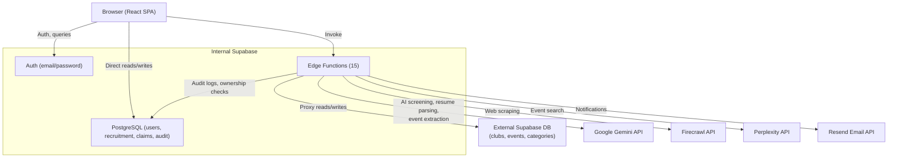
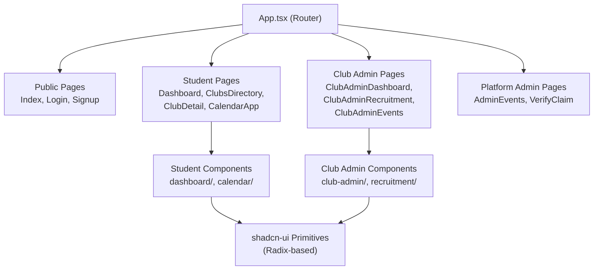
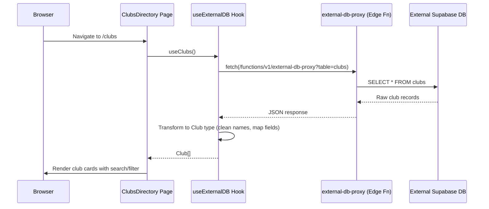
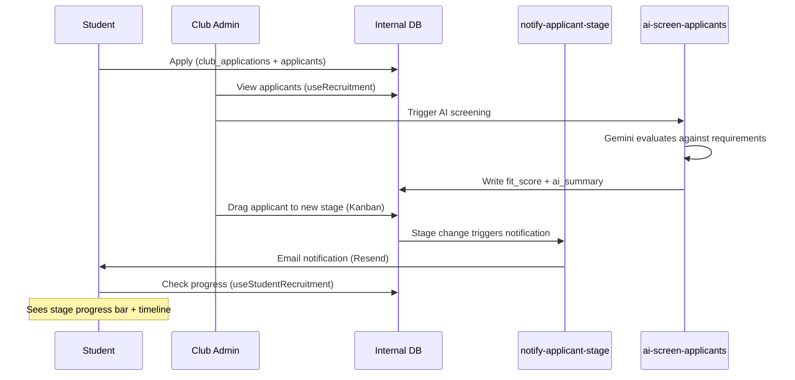
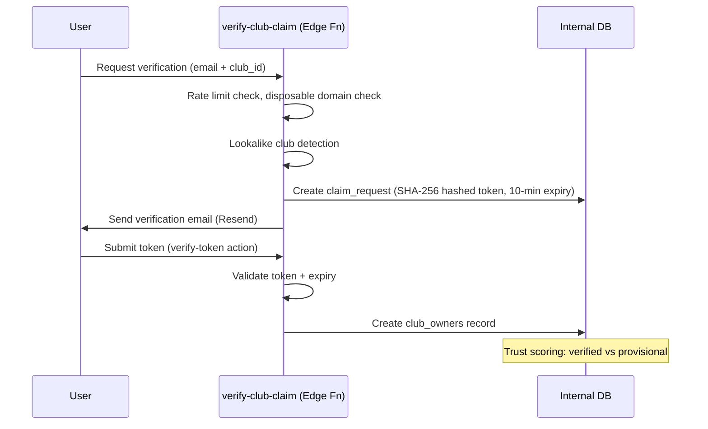

# UniCircle Connect — Architecture

## 1. Overview

UniCircle Connect is a student club discovery and management platform for UCSD. It serves three user roles:

- **Students** — Browse clubs/events, save favorites, submit applications, track recruitment progress
- **Club Owners** — Manage club profiles, events, and recruitment pipelines (Kanban board with AI screening)
- **Platform Admins** — Approve submitted events, manage club claims, oversee the catalog

## 2. Tech Stack

| Layer | Technologies |
|-------|-------------|
| **Frontend** | React 18, TypeScript 5.8, Vite 5.4, React Router 7 |
| **Styling** | Tailwind CSS 3.4, shadcn-ui (Radix primitives), Framer Motion |
| **State & Data** | Custom hooks + Supabase client, TanStack React Query 5 (caching) |
| **Forms** | React Hook Form + Zod |
| **Drag-and-Drop** | @dnd-kit (core + sortable) |
| **Calendar** | FullCalendar (daygrid + timegrid) |
| **Backend** | Supabase (PostgreSQL, Auth, Edge Functions, RLS) |
| **AI / Scraping** | Google Gemini (screening, resume parsing, event extraction), Firecrawl (web scraping), Perplexity (search) |
| **Email** | Resend (transactional emails) |
| **Testing** | Playwright (E2E) |

## 3. System Architecture



### Dual-Database Design

The platform uses two separate Supabase instances:

- **Internal DB** — User accounts, recruitment pipelines, club claims, saved clubs, audit logs
- **External DB** — The public club/event catalog (scraped from UCSD sources). Accessed exclusively through the `external-db-proxy` edge function, which enforces ownership and admin auth before proxying writes.

## 4. Frontend Architecture

### Routing

Routes are defined in `src/App.tsx` via React Router v7:

| Group | Routes | Auth |
|-------|--------|------|
| **Public** | `/`, `/login`, `/signup`, `/forgot-password`, `/reset-password`, `/terms`, `/privacy`, `/social-assets` | None |
| **Student** | `/dashboard`, `/clubs`, `/clubs/:id`, `/events`, `/calendar`, `/express-interest`, `/submit-event`, `/onboarding` | Logged in |
| **Club Admin** | `/club-admin`, `/club-admin/clubs/:clubId/events`, `/club-admin/clubs/:clubId/edit`, `/club-admin/clubs/:clubId/recruitment`, `/club-admin/profile` | Club owner |
| **Platform Admin** | `/admin/events`, `/admin-onboarding`, `/verify-claim` | Admin role |

### Component Hierarchy



### State Management

There is no global state store. Each domain has a dedicated custom hook that encapsulates Supabase queries and local state:

| Hook | Domain |
|------|--------|
| `useAuth` | Session management (Supabase `onAuthStateChange` listener) |
| `useExternalDB` | Club/event catalog from external DB (`useClubs`, `useEvents`) |
| `useExternalClubRecord` | Single club detail from external DB |
| `useExternalEvents` | Events with 30-second polling |
| `useClubMemberships` | Applications, memberships (apply/withdraw/add/remove) |
| `useClubOwnership` | Club owner records, trust-level checks (`isVerified`, `isProvisional`) |
| `useRecruitment` | Recruitment pipeline (stages, applicants, CSV import, stage moves) |
| `useRecruitmentRequirements` | Strict filters + AI criteria per club |
| `useStudentRecruitment` | Student-side application tracking with progress percentage |
| `useSavedClubs` | Save/unsave clubs |
| `useUserInterests` | Onboarding interests (delete-then-insert pattern) |
| `useEventRecommendations` | Score events against user interests |
| `useAdminProfile` | Admin display name, role, avatar |

All hooks follow the pattern: `{ data, loading, error, ...methods }`.

## 5. Data Flow Diagrams

### Club Discovery Flow



### Recruitment Pipeline Flow



### Club Ownership Verification Flow



## 6. Backend Architecture

### Database Tables (Internal Supabase)

| Domain | Tables |
|--------|--------|
| **Users & Auth** | `profiles`, `user_roles`, `admin_profiles`, `user_interests`, `waitlist` |
| **Clubs** | `saved_clubs`, `club_memberships`, `club_applications` |
| **Ownership** | `club_owners`, `club_claim_requests`, `claim_rate_limits`, `new_club_requests`, `ownership_transfers`, `email_domain_rules`, `disposable_domains` |
| **Recruitment** | `applicants`, `recruitment_stages`, `recruitment_settings`, `recruitment_requirements` |
| **Events** | `event_sources` |
| **Admin** | `admin_audit_log` |

**External DB tables** (accessed only via `external-db-proxy`): `clubs`, `events`, `categories`, `interests`, `raw_club_pages`

### Edge Functions

| Function | Purpose |
|----------|---------|
| `external-db-proxy` | Secure proxy to external DB; enforces ownership for writes, admin auth for admin ops |
| `ai-screen-applicants` | Gemini AI evaluates applicants against club requirements; writes `fit_score` + `ai_summary` |
| `extract-resume-keywords` | Gemini AI parses resume text into categorized keywords for club matching |
| `extract-event-from-flyer` | Gemini Vision extracts structured event data from flyer images |
| `verify-club-claim` | Two-step club ownership verification (send token + verify token) with trust scoring |
| `notify-applicant-stage` | Emails applicant on recruitment stage advancement (interview/accepted/offer) |
| `notify-event-approved` | Emails club owner when submitted event is admin-approved |
| `notify-waitlist-signup` | Confirmation email for waitlist signups |
| `scrape-club-emails` | Firecrawl scrapes studentorg.ucsd.edu for club emails, websites, Instagram |
| `scrape-club-websites` | Firecrawl + Gemini extracts events from club websites |
| `scrape-events` | Perplexity + Gemini finds and structures UCSD campus events |
| `scrape-eventbrite` | Perplexity + Firecrawl + Gemini extracts Eventbrite events |
| `scrape-instagram` | Firecrawl + Gemini extracts events from club Instagram posts |
| `sync-club-eventbrite` | Matches Eventbrite organizers to clubs and upserts events |
| `discover-club-websites` | Firecrawl web search finds official websites for clubs |

### Auth & Authorization

- **Authentication**: Supabase Auth with email/password. Session managed via `onAuthStateChange` listener in `useAuth`.
- **Roles**: Stored in `user_roles` table with an `app_role` enum (student, club owner, admin).
- **Club ownership**: `club_owners` table with `verification_state` and `trust_level` enums. Provisional owners have restricted capabilities.
- **RLS**: Row-level security on sensitive tables. Edge functions perform additional ownership/admin checks before proxying writes to the external DB.

## 7. Key Architectural Patterns

### Hook-Based State Management
Each domain has a single hook (`useRecruitment`, `useClubMemberships`, etc.) that owns all queries and mutations for that domain. No global store — components compose hooks as needed.

### External DB Proxy Pattern
The external club/event catalog lives in a separate Supabase instance. All frontend access is brokered through the `external-db-proxy` edge function, which:
- Never exposes external DB credentials to the client
- Validates table names against an allowlist
- Enforces club ownership for event writes
- Requires admin role for admin operations
- Logs all mutations to `admin_audit_log`

### Client-Side Club Recommendations
`src/lib/clubRecommendations.ts` implements a keyword-clustering engine (no ML model or server call):
1. ~30 static keyword clusters map domain terms (e.g., `computer_science` → ["programming", "software", "hackathon", ...])
2. Club names/descriptions are tokenized and matched against clusters
3. A user's saved clubs + onboarding interests build a keyword profile
4. All unsaved clubs are scored by keyword overlap and ranked

The same interest-keyword mapping is reused in `useEventRecommendations` for event scoring.

### Kanban Recruitment Pipeline
Club admins manage applicants via a drag-and-drop Kanban board (powered by `@dnd-kit`). Each club defines custom `recruitment_stages` with ordered columns. Moving an applicant to interview/accepted/offer stages auto-triggers an email notification via the `notify-applicant-stage` edge function.

### Progressive Club Owner Verification
Club ownership follows a trust-score model:
- **Provisional** — Unverified claim, restricted capabilities, time-limited
- **Verified** — Email token verified with institutional domain, full access
- Rate limiting, disposable domain blocking, and lookalike detection prevent abuse

## 8. Directory Structure

```
unicircle-connect/
├── docs/                        # Architecture documentation
├── public/                      # Static assets
├── src/
│   ├── App.tsx                  # Router configuration (all routes)
│   ├── main.tsx                 # React entry point
│   ├── index.css                # Tailwind base + custom theme tokens
│   ├── assets/                  # Images, logos
│   ├── components/
│   │   ├── ui/                  # shadcn-ui primitives (40+ components)
│   │   ├── calendar/            # Calendar views, event modals
│   │   ├── club-admin/          # Club admin UI (sidebar, event mgmt, onboarding)
│   │   ├── dashboard/           # Student dashboard sections
│   │   ├── onboarding/          # Resume upload, interest selection
│   │   └── recruitment/         # Kanban board, applicant cards, CSV import
│   ├── data/
│   │   └── mockData.ts          # Shared TypeScript types (Club, Event, etc.)
│   ├── hooks/                   # 15 custom hooks (one per domain)
│   ├── integrations/
│   │   └── supabase/            # Supabase client + auto-generated types
│   ├── lib/
│   │   ├── clubRecommendations.ts  # Keyword-clustering recommendation engine
│   │   └── utils.ts             # cn() utility for Tailwind class merging
│   └── pages/                   # 26 route components
├── supabase/
│   ├── functions/               # 15 Edge Functions
│   └── migrations/              # 27+ SQL migration files
├── components.json              # shadcn-ui configuration
├── tailwind.config.ts           # Custom theme (gold, navy, charcoal, fonts)
└── vite.config.ts               # Vite config (path alias @/ → src/)
```
