# UniCircle — Student User Flow

Club discovery & recruitment flow for UCSD students. This diagram is the source of truth for the student-facing experience. Edit the Mermaid block below and it re-renders automatically on GitHub and in any Mermaid-aware editor.

```mermaid
%%{init: {'theme':'base','themeVariables':{'fontFamily':'DM Sans, sans-serif','fontSize':'14px'}}}%%
flowchart TD

    %% PHASE 1 — ENTRY & AUTH
    subgraph P1[" 1 · ENTRY & AUTH "]
        direction TB
        Start([Landing Page]) --> Auth{New or<br/>returning?}
        Auth -->|New| SignUp[Sign Up<br/>Email / OAuth]
        Auth -->|Returning| LogIn[Log In]
        SignUp --> ConfEmail[/Email: confirm account/]
        LogIn --> Returning{Onboarding<br/>complete?}
    end

    %% PHASE 2 — ONBOARDING
    subgraph P2[" 2 · ONBOARDING "]
        direction TB
        Quiz[Passion Quiz<br/>arts · activism · sports<br/>finance · community]
        Quiz --> ResumeQ{Upload<br/>resume?}
        ResumeQ -->|Yes| Resume[Resume Upload]
        Resume --> Parse[/Algorithm: parse resume<br/>+ match — 60% interests<br/>40% resume signals/]
    end

    ConfEmail --> Quiz
    Returning -->|No| Quiz
    Returning -->|Yes| Match
    ResumeQ -->|Skip| Match
    Parse --> Match

    %% PHASE 3 — DISCOVERY
    subgraph P3[" 3 · DISCOVERY "]
        direction TB
        Match[Top 10 Clubs Page<br/>match % · reason · recruiting badge]
        Match --> ClubAction{Action}
        ClubAction -->|Save| Saved[/Save club to profile/]
        ClubAction -->|Compare| Compare[Compare Clubs]
        ClubAction -->|View Detail| Detail
        Saved --> Match
        Compare --> Match

        Feed[For You Feed<br/>All · Recruiting · Events · Posts<br/>bulletin board]
        Feed --> AIChat[/AI chat: club recs/]
        AIChat --> Match
    end

    Match --> Feed
    Feed --> Detail

    %% PHASE 4 — CLUB DETAIL
    subgraph P4[" 4 · CLUB DETAIL "]
        direction TB
        Detail[Club Detail Page<br/>About · Events · Board · Reviews]
        Detail --> Events[Events Tab — RSVP]
        Events --> Detail
        Detail --> Recruiting{Recruiting?}
        Recruiting -->|No| Detail
        Recruiting -->|Yes| ApplyBtn[Apply Now]
    end

    %% PHASE 5 — APPLICATION
    subgraph P5[" 5 · APPLICATION "]
        direction TB
        AppForm[Application Flow<br/>standard + custom questions<br/>resume · optional video]
        AppForm --> Submit[/Submit + confirmation email/]
    end

    ApplyBtn --> AppForm

    %% PHASE 6 — APPLICATION TRACKER
    subgraph P6[" 6 · APPLICATION TRACKER "]
        direction TB
        Tracker[Application Tracker]
        Tracker --> S1[Applied] --> S2[Round 1] --> S3[Round 2] --> S4[Final Round] --> Decision{Decision}
        Decision -->|Accepted| Celebrate([Celebration Screen])
        Decision -->|Rejected| Reject([Graceful Rejection])
    end

    Submit --> Tracker
    S1 -.->|stage email| Emails
    S2 -.->|stage email| Emails
    S3 -.->|stage email| Emails
    Decision -.->|decision email| Emails

    %% CROSS-CUTTING — NOTIFICATIONS & EMAILS
    subgraph PX[" NOTIFICATIONS  (always available) "]
        direction TB
        Emails[/Email engine: stage advance ·<br/>accepted · rejected/]
        Bell[Notification Bell<br/>· stage advance<br/>· decision<br/>· event from saved club<br/>· emoji reaction from club]
    end

    Emails -.-> Bell
    Bell -.-> Tracker
    Bell -.-> Detail

    %% STYLES
    classDef screen fill:#b5872a,stroke:#8a6620,stroke-width:1px,color:#fff;
    classDef system fill:#1a1a1a,stroke:#f5c122,stroke-width:1px,color:#f5c122;
    classDef terminal fill:#f5c122,stroke:#b5872a,stroke-width:2px,color:#1a1a1a;
    classDef decision fill:#2a2a2a,stroke:#b5872a,stroke-width:1.5px,color:#fff;

    class SignUp,LogIn,Quiz,Resume,Match,Compare,Detail,Events,ApplyBtn,AppForm,Tracker,S1,S2,S3,S4,Feed,Bell screen;
    class ConfEmail,Parse,Saved,Submit,AIChat,Emails system;
    class Start,Celebrate,Reject terminal;
    class Auth,Returning,ResumeQ,ClubAction,Recruiting,Decision decision;

    style P1 fill:none,stroke:#3a3a3a,stroke-width:1px,color:#888;
    style P2 fill:none,stroke:#3a3a3a,stroke-width:1px,color:#888;
    style P3 fill:none,stroke:#3a3a3a,stroke-width:1px,color:#888;
    style P4 fill:none,stroke:#3a3a3a,stroke-width:1px,color:#888;
    style P5 fill:none,stroke:#3a3a3a,stroke-width:1px,color:#888;
    style P6 fill:none,stroke:#3a3a3a,stroke-width:1px,color:#888;
    style PX fill:none,stroke:#5a4a1a,stroke-width:1px,color:#f5c122;
```

## Legend

| Shape | Meaning |
|---|---|
| `([ rounded ])` gold-fill | Start / end terminal |
| `[ rectangle ]` gold | Screen / page the student sees |
| `[/ parallelogram /]` dark, gold text | System / algorithm action (email, parse, save) |
| `{ diamond }` | Decision point |
| solid arrow | User navigation |
| dotted arrow | Notification / email trigger (fires in background) |

## Phases

1. **Entry & Auth** — landing, sign up / log in, confirmation email. Returning users skip onboarding if already complete.
2. **Onboarding** — passion quiz (interest-based, not career-focused), optional resume upload, match algorithm (60% interests / 40% resume signals).
3. **Discovery** — Top 10 ranked clubs, For You feed, AI chat recommendations. Save / Compare / View actions.
4. **Club Detail** — About / Events / Board / Reviews tabs. Apply button gated on recruiting status.
5. **Application** — standard + custom questions, resume + optional video, confirmation email.
6. **Application Tracker** — Applied → Round 1 → Round 2 → Final Round → Decision. Emails fire on every advance. Ends at Celebration or Graceful Rejection.

**Notifications** are cross-cutting: the email engine and notification bell are driven by stage advances, decisions, saved-club events, and post-event reactions — available from anywhere in the app.
